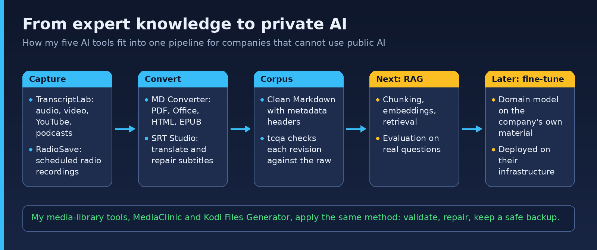
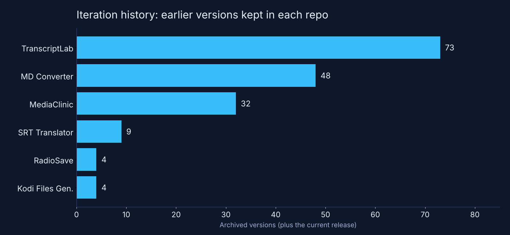

# Hi, I'm Luiz Junqueira 👋

**Infrastructure & renewable energy investment professional (20+ years, PMP) who builds private, local-first AI tools.**
Zürich, Switzerland · [junqueira.ch](https://www.junqueira.ch) · [LinkedIn](https://www.linkedin.com/in/luizjunqueira/)

I have spent nearly two decades developing, financing and delivering hydropower, solar and gas assets across Latin America, Africa and Europe. Today I combine that domain knowledge with hands-on AI engineering.

## What I'm working on

**Turning expert knowledge into private AI.** Energy and infrastructure companies hold know-how and trade secrets they cannot paste into a public chatbot. I am building the pipeline to make that knowledge usable by AI *on their own infrastructure*:

`recordings / PDFs / documents / subtitles` → **clean Markdown corpus** → **AI revision, checked** ([tcqa](https://github.com/junqueirach/transcript-corpus-qa)) → **RAG** (retrieval-augmented generation) → *later:* **fine-tuning** a model on the company's own material

## Projects

All tools were built with Claude (Anthropic) as coding partner. I write the requirements, test on real data and iterate. Every earlier version is kept in each repo's `archive/` folder.

| Project | What it does | Size |
|---|---|---|
| [**TranscriptLab**](https://github.com/junqueirach/transcriptlab) | Whisper transcription with checked model downloads, YouTube/podcast capture and Markdown polishing into a RAG-ready corpus. Windows .exe download in Releases, update check built in | ~30k lines, 76 versions |
| [**MD Converter**](https://github.com/junqueirach/md-converter) | PDF/Office/HTML/EPUB, subtitles and more to Markdown with local engines: light ones run in parallel workers, heavy ones (Docling, marker, MinerU, Surya…) in isolated environments with checked installs. Batch queue that survives a restart, quality badges, corpus export. Windows .exe download in Releases, update check built in | ~11.4k lines, 50 versions |
| [**tcqa**](https://github.com/junqueirach/transcript-corpus-qa) | AI revision of speech-to-text transcripts that can be checked: a Claude Code agent corrects a whole corpus and a second agent re-checks every correction; then an offline checker (no AI) proves each transcript changed only what its log says, before the text enters a RAG or fine-tuning corpus | Agent + checker, 14 checks, 238 tests, CI on Ubuntu and Windows |
| [**RadioSave**](https://github.com/junqueirach/radiosave) | Scheduled recorder for online radio: captures interviews and author programs unattended, as raw material for the transcript pipeline. Records every station in its own time zone, resumes dropped streams. Windows .exe download in Releases, update check built in | ~8.9k lines, 6 versions |
| [**SRT Studio**](https://github.com/junqueirach/srt-studio) | Subtitle translation, repair and sync with Claude (formerly SRT Translator): SRT, ASS/SSA, WebVTT and other text formats, sync to another subtitle or to the video's audio, subtitles taken from MKV/MP4, source check and repair, quality control, live pricing and cost estimates. Windows .exe download in Releases | ~9.3k lines, 14 versions |

## How I work with AI

- Write a clear brief first, then iterate in small versioned steps
- Give the AI rules it must obey (module boundaries, naming, safety checklists); [MediaClinic](https://github.com/junqueirach/mediaclinic) shows this written contract in practice
- Test on real data, log everything, fix the root cause
- Keep the history public
- Keep confidential data local and secrets out of the code

## Engineering roots

Not everything here is AI. I am a civil engineer by training, and one older project belongs on this page.

**[dlearn-ppd](https://github.com/junqueirach/dlearn-ppd)** is my 2001 civil-engineering graduation project at UNESP Bauru, rebuilt for current machines. It comes from research on dynamic structural analysis: DLEARN, the finite-element program published with T.J.R. Hughes' textbook, extended with Prof. Heitor M. Bottura's Hermitian time-integration algorithms. The pre-processor I wrote in Turbo Pascal generates DLEARN's input files from a question-and-answer dialogue. In 2026 I rebuilt DLEARN with gfortran and, with Claude, added a tested Python rewrite of the pre-processor. Checking my 2001 program against the Fortran exposed three bugs in it, documented in the repo.

## 🎬 Off the clock: my own media library

One of my hobbies is keeping my films and series in my own offline library: rips of the DVDs and Blu-rays I have bought, served from a home media server or NAS to **Plex, Kodi, Emby or Jellyfin**. I use the tools below every day, and they are built for people who run the same kind of library.

**Why keep your own copies?** Streaming catalogues change without asking you. Titles leave with little or no notice, sometimes in the middle of a series, and the subscription price does not go down when the catalogue shrinks. A disc on my shelf and a file on my disk are still there next year: in the quality I chose, with the audio and subtitle languages I want, with no account, no licence server and no internet connection needed.

The catch is that a big library only works if it is tidy. Missing artwork, wrong IDs, broken metadata files and inconsistent genres make **Plex, Kodi, Emby or Jellyfin** show the wrong movie, or none at all. These tools keep it healthy:

| Tool | What it does |
|---|---|
| [**MediaClinic**](https://github.com/junqueirach/mediaclinic) | For **Plex, Kodi, Emby and Jellyfin users**: scans a movie library, shows every metadata, artwork and video problem in one colour-coded table and fixes the common ones safely. It checks Kodi `.nfo` and Emby/Jellyfin `movie.xml` files, so it also suits **Plex with an NFO add-on**. Windows .exe download in Releases |
| [**Kodi Files Generator**](https://github.com/junqueirach/kodi-files-generator) | For **Kodi, Jellyfin and Emby users**: opens a TV series folder, takes the episode data from your own CSV or Excel list or from free sources (TheTVDB pages, TVmaze), and writes every episode and series NFO, XML and image after a preview, with backup and undo. Windows .exe download in Releases |

Subtitles are part of the same job: I use [**SRT Studio**](https://github.com/junqueirach/srt-studio) (formerly SRT Translator, listed under AI projects above) to translate, repair and sync the subtitles of the films I own; [MD Converter](https://github.com/junqueirach/md-converter) turns subtitle files into Markdown for my transcript corpus.

*This is about keeping what I have bought, not about piracy. Rules on copying discs differ by country, so check yours.*

## Tech

Python · Tkinter · Whisper · MarkItDown · Docling · ffmpeg · yt-dlp · pysubs2 · Claude API · Claude Code agents · Markdown pipelines · RAG concepts · Kodi/Plex NFO and XML metadata · pytest · GitHub Actions CI · PyInstaller Windows builds

## Get in touch

Open to senior roles in infrastructure and renewables, and to conversations about private AI for energy companies.
📧 junqueira.ch@gmail.com · 🌐 [junqueira.ch](https://www.junqueira.ch)
